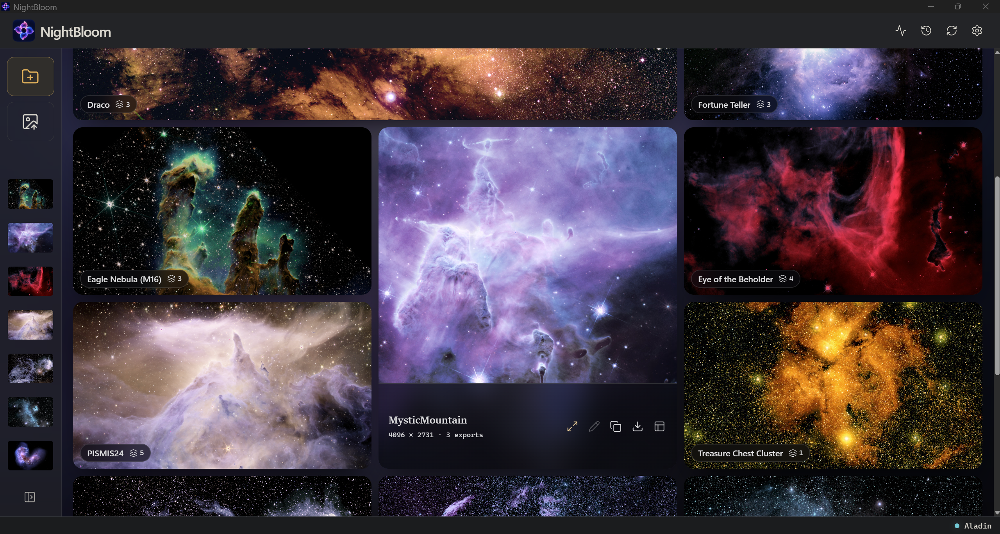
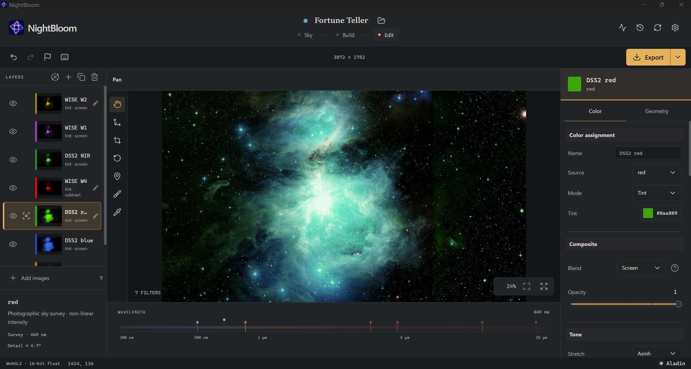

# NightBloom

Turn real Hubble, JWST and survey images into your own false-colour astronomy art.
Find a patch of sky, choose images, mix colours live, and export. Everything runs locally.

| Mystic Mountain | Draco | The Rose |
| --- | --- | --- |
| [](docs/images/mystic-mountain.webp) | [](docs/images/draco.webp) | [](docs/images/the-rose.webp) |

Made with NightBloom. Click any image to enlarge.

## Get started

1. Download the **[Windows installer or portable ZIP](https://github.com/logar16/NightBloom/releases)**.
   For portable, extract the whole ZIP before opening `astroimp-desktop.exe`.
2. Open NightBloom and choose a **library folder** for your projects and downloads.
3. Choose **New project**, search for a target, select images on **Sky**, then **Build**.
   Pick colours in **Edit** and save your image with **Export**.

Windows 10/11 x64, WebView2 and WebGL2-capable graphics are required.
The installer can fetch WebView2. No Python or Aladin needed.
This is an **unsigned preview**.

**[Full setup, optional Aladin and troubleshooting](docs/GETTING_STARTED.md)**

## A look inside

| Home: your artwork and projects | Edit: layers, colours and export |
| --- | --- |
| [](docs/images/home.webp) | [](docs/images/editor.webp) |

## Working on the code

Point your coding agent at **[AGENTS.md](AGENTS.md)** first: architecture, safety
rules and test commands. The **[detailed reference](docs/REFERENCE.md)** covers
features, CLI commands, packaging and the alternative Python backend.

To run the desktop from source, install Node.js 22.12+, stable Rust and the
Visual Studio C++ Build Tools, then:

```powershell
cd frontend
npm ci
npm run desktop:dev
```

Code: [MIT](LICENSE) · [Third-party notices](THIRD_PARTY_NOTICES.md).
Astronomy imagery remains subject to its providers' terms and credit requirements.
